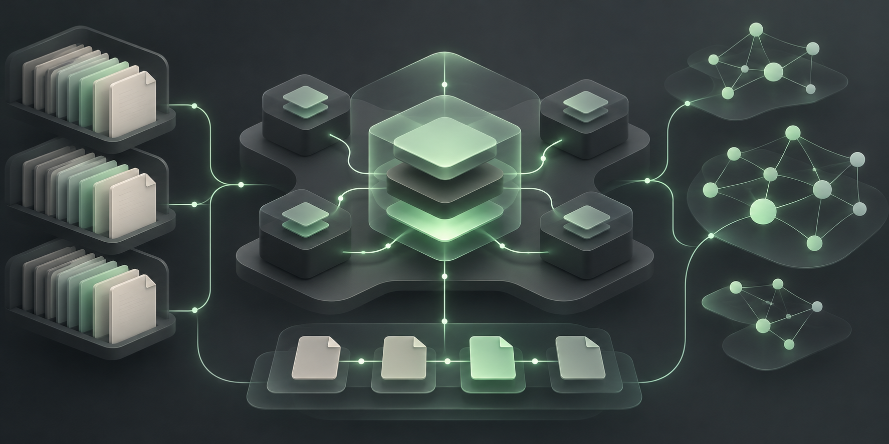
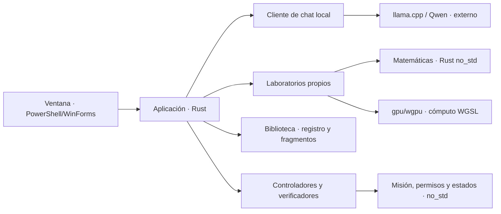

# Boddy 1.0


**Una IA personal desde Perú, construida para entender sus piezas y comprobar
su evolución.** Proyecto de Eddi Salazar con modelos propios en Rust/WGSL,
biblioteca documental y controladores de tareas. Hoy es una base experimental;
todavía no es un asistente conversacional propio de propósito general.

*Portada conceptual. Las capacidades comprobadas se describen más abajo.*

## Por qué nació

Boddy nació como una respuesta personal a depender de servicios de IA comerciales:
el deseo de construir una herramienta propia, aprender cómo funciona y conservar
control sobre sus datos, pesos, componentes y registros de trabajo.

La apuesta por Rust responde a ese objetivo de control y modularidad. Los modelos
propios se entrenan y generan sin Python; la ventana actual usa PowerShell/WinForms
y algunas herramientas de mantenimiento usan Node.js. El chat opcional Qwen usa
un motor externo C++.

La independencia se evaluará con tareas, mediciones y pruebas. La capacidad del
modelo depende también de su arquitectura, datos y entrenamiento; elegir Rust
por sí solo no establece ventaja de calidad o consumo frente a otros sistemas.

**El nombre fue elegido al azar por su creador. No viene del nombre de un perro.**
El proyecto nace en Perú.

## En qué parte estamos

**Etapa actual: infraestructura funcional y modelos propios educativos.**
Hay aprendizaje numérico real, persistencia y recuperación documental, pero falta
conversación útil con el modelo propio y programación general verificada.

| Pieza | Qué funciona | Límite actual |
|---|---|---|
| Aplicación Windows | Chat local, lectura del proyecto, paneles y métricas | La conversación actual depende de Qwen; sus capacidades no se atribuyen a los pesos propios |
| [Tiny 1.0](docs/MODELO-PROPIO.md) | MLP de 27.776 parámetros, entrenamiento WGPU, checkpoints reanudables | ASCII, ocho caracteres de contexto; experimento educativo |
| [Attention 0.1](docs/ATTENTION.md) | Decoder propio: UTF-8, embeddings, atención causal y entrenamiento WGPU | 10.544 parámetros, 16 bytes de contexto; todavía sin diálogo útil |
| [Escuela Rust](docs/ESCUELA-RUST.md) | Ranking neuronal, propuestas, verificación y revisiones acotadas | Nueve expresiones conocidas; 1/6 elecciones iniciales y 2/6 tras búsqueda en la medición registrada |
| [Biblioteca](docs/BIBLIOTECA.md) | Cinco categorías, 14 fichas, referencias, relectura y exportación | Material inicial; no se incorpora automáticamente a los modelos ni modifica sus pesos |
| [Controlador](docs/MODULARIDAD.md) | Misiones, permisos, cupos y verificación en un núcleo no_std | Ejecutor aislado y autonomía general pendientes |

La biblioteca incluye 8.276 registros de idioma IANA, con alias y rangos; no son
8.276 cursos completos ni idiomas aprendidos por Boddy. Las 56 pruebas registradas
comprueban contratos y comportamientos del software, no una medida de inteligencia
general. Evidencia, hardware y límites en [Estado vigente](docs/ESTADO.md).

## Qué queremos construir

Un asistente personal que pueda conversar con continuidad, desarrollar ideas,
consultar información con procedencia, preparar soluciones y verificar resultados.
Su identidad podrá ser directa, crítica y sarcástica; ese estilo no sustituirá
la precisión ni la capacidad de reconocer incertidumbre.



*Ilustración conceptual de la visión. El grafo documental organiza referencias;
los parámetros neuronales se entrenan por separado. El diagrama de arquitectura
posterior describe las conexiones implementadas.*

El siguiente salto técnico es ampliar el contexto con cómputo tensorial paralelo,
datos de lenguaje y diálogo, y evaluaciones separadas. El intérprete GPU actual
es una referencia funcional; no se afirma que sea más rápido que CPU. Más capas,
más datos o más pasos solo cuentan como mejora cuando las mediciones lo muestran.

## Probar Boddy

Para abrir los laboratorios propios y la biblioteca sin iniciar Qwen:

```powershell
cargo build -p boddy-cli --offline
powershell.exe -NoProfile -ExecutionPolicy Bypass -STA -File .\window\Boddy.ps1
```

No hace falta descargar Qwen para esos paneles. Rust, sus dependencias y un
controlador Vulkan compatible sí son necesarios para entrenar con WGPU.

Para abrir también el chat Qwen preparado en este proyecto:

Doble clic en `window/Boddy.vbs`, o:

```powershell
powershell.exe -NoProfile -ExecutionPolicy Bypass -STA -File .\window\Start-Boddy.ps1
```

Enter envía, Shift+Enter agrega una línea. Nuevo chat borra el historial en memoria.
Activa **Investigar proyecto (lectura)** para un objetivo como «Explica cómo
budget.rs limita los tokens». Boddy buscará fuentes, leerá fragmentos y entregará
un informe con citas comprobadas y ruta del registro local.
El chat no tiene herramientas para leer tus archivos o ejecutar programas.
La respuesta se muestra al finalizar; el historial reciente se recorta con límites.

Primera preparación en otro equipo: `tools/Install-Model.ps1` descarga motor y
pesos oficiales y verifica SHA256. Son unos 4,7 GB de modelo, conservados fuera de
Git. `models.lock.json` fija formato, origen y hashes. El motor permanece cargado;
`tools/Stop-Model.ps1` lo detiene para liberar recursos. [Detalles](window/README.md).

## Arquitectura

Veinte crates: contratos, misión, permisos, controlador, catálogo, biblioteca, SUPER GRAFO,
inferencia local, telemetría, lector, agente, escritorio, aplicación, CLI, lanzador
gráfico, red neuronal de referencia, Transformer, ejercicios Rust, adaptador WGPU y laboratorio.
Contratos, misión, política, controlador y referencias matemáticas conservan no_std;
los servicios de disco, procesos y ventanas pertenecen al host.
El host usa serde_json; GPU y ventana no entran en el núcleo.

El chat usa Vulkan mediante un proceso externo; el laboratorio usa WGPU propio.
El sandbox del SO y la ejecución operativa de tareas siguen pendientes.
Los tokens son unidades internas de texto del modelo; el cómputo es local,
sin clave ni pago a un proveedor por token.



El diagrama resume las fronteras implementadas. Separar crates organiza las
dependencias; no constituye aislamiento de seguridad del sistema operativo.

- [Reglas](AGENTS.md) y [fronteras](docs/MODULARIDAD.md).
- [Propósito](docs/PROPOSITO.md), [investigación](docs/INVESTIGACION.md) y [plan](docs/PLAN.md).
- [Estado y comprobaciones](docs/ESTADO.md).
- [Tokens, GPU y presupuestos](docs/RECURSOS.md).
- [Agente de lectura con citas verificadas](docs/AGENTE-LECTURA.md).
- [Programar, Mi PC y Evidencia en Windows](docs/ESCRITORIO.md).
- [Evolución y evaluaciones del agente](docs/EVOLUCION.md).
- [Mapa](super-grafo/MAPA.md) y `super-grafo/nodos.json`.
- [Ilustraciones, prompts y procedencia](assets/identity/README.md).

## Comprobar y mantener

```powershell
cargo test --workspace --offline
cargo clippy --workspace --all-targets --offline -- -D warnings
cargo check -p boddy-core --target wasm32-unknown-unknown --offline
cargo run -p boddy-cli --offline -- fuentes python
cargo run -p boddy-cli --offline -- grafo resumen
.\tools\Update-SuperGrafo.ps1
```

El adaptador del chat solo conecta a 127.0.0.1:17861. No hace peticiones de
inferencia a servidores remotos. El catálogo de fuentes conserva metadatos;
la Biblioteca añade notas propias y una instantánea de datos IANA. No existe
una ingesta general de toda la web. Actualizar el mapa requiere Node.js y Cargo.
