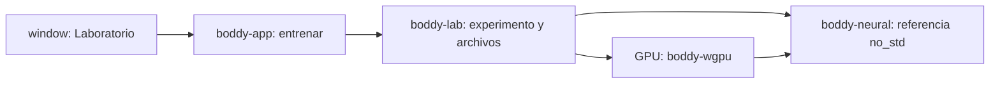

# Boddy Tiny 1.0: aprender a entrenar desde cero

Decisión del dueño: construir una arquitectura pequeña para aprender a entrenarla
en su RTX 3060 de 12 GB. Tiny es un modelo educativo de texto con pesos propios;
el chat y el investigador continúan usando Qwen. No hay extracción de documentos,
neuronas o datos originales de Qwen ni transferencia de sus pesos.

## Arquitectura y fronteras



MLP: contexto de ocho caracteres codificados one-hot, 32 unidades tanh, 96
salidas softmax. Son **27.776 parámetros**, 111.104 bytes de pesos f32.
Cada token equivale a un carácter: salto de línea o ASCII imprimible. No soporta
acentos, Unicode, instrucciones largas, atención ni herramientas. El núcleo
matemático usa no_std con alloc; requiere un asignador del consumidor.

Inicialización uniforme aleatoria de pesos, sesgos cero, semilla 1337. Pérdida de
entropía cruzada y SGD con tasa 0,2; lote 32, hasta 2.000 pasos. Forward, backprop
y actualización corren en shaders WGSL escritos en este repositorio. La muestra
de 256 caracteres se genera después con la referencia CPU, semilla 2026.

El corpus propio versionado `training/corpora/boddy-tiny-v1.txt` tiene 2.403 bytes
y frases educativas creadas para este experimento. No proviene de Qwen, del chat
del usuario ni de una descarga. Se reserva el último 20 % de líneas antes de
construir contextos. Se comparan los mismos 256 contextos distribuidos por cada
partición antes y después. Este corpus relacionado y diminuto no demuestra
generalización, capacidad para programar ni razonamiento.

## Usarlo

Abrir Boddy y seleccionar **Laboratorio**, elegir 300, 1.000 o 2.000 pasos y
pulsar **Entrenar en GPU**. Cada ejecución comienza desde cero; aumentar los
pasos no reanuda el checkpoint anterior. También funciona sin servidor Qwen:

```powershell
cargo build -p boddy-cli --offline
'{"steps":1000}' | .\target\debug\boddy-cli.exe entrenar
# Ventana sin iniciar Qwen:
powershell.exe -NoProfile -ExecutionPolicy Bypass -STA -File .\window\Boddy.ps1
```

El host guarda `data/lab/tiny-<id>/checkpoint.json`, `metrics.json` y `sample.txt`;
están ignorados por Git. Checkpoint contiene configuración, tokenizer, semilla y
todos los pesos; se comprueba su serialización, se relee el archivo y se exige
que los pesos restaurados reproduzcan la muestra. No hay todavía comando para
reanudar o conversar con este checkpoint.

La pantalla muestra pérdida de entrenamiento/validación, GPU real, tiempo,
tokens objetivo procesados, contexto por lote, pesos y buffers. Los 239.904 bytes
de buffers declarados excluyen compilador, driver, staging y otros procesos; no
son consumo total ni pico de VRAM. Tokens procesados incluyen repeticiones del
corpus y no significan datos nuevos.

## Comprobaciones y evolución

Antes de entrenar se compara pérdida y todos los gradientes GPU contra CPU,
además de una actualización SGD. Umbrales absolutos: pérdida 1e-4, gradientes y
actualización 5e-4. Las pruebas CPU incluyen diferencias finitas de gradientes,
descenso de pérdida y rechazo de tensores inválidos. El laboratorio comprueba
también límites del comando y alfabeto. La prueba nativa de ventana ejecuta
realmente el entrenamiento y comprueba el resultado sin alterar el chat.

Resultado observado desde la ventana en RTX 3060, 1.000 pasos: entrenamiento
4,5659 -> 1,8081; validación 4,5703 -> 2,1641. Error máximo absoluto de gradiente
7,45e-9. Registro versionado: `evals/tiny-v1-rtx3060.json`; contiene semilla,
hash del corpus y métricas de esa ejecución. El tiempo de una ejecución incluye
preparación y verificaciones; no es un benchmark estable de rendimiento.

Para crecer: primero corpus y evaluación independientes; luego soporte Unicode,
embeddings y contexto mayor, comparados con esta línea base. Un Transformer,
optimizadores como Adam, reanudación, evaluación de código y autonomía operativa
son trabajo futuro. Añadir parámetros sin datos ni evaluación no garantiza mejoras.
La formación de un asistente general desde cero excede el alcance de este prototipo.

API contrastada con las fuentes oficiales de
[WGPU](https://docs.rs/wgpu/30.0.1/wgpu/) y
[libm](https://docs.rs/libm/latest/libm/). Las implementaciones y los pesos de este
experimento están en el proyecto; estas bibliotecas aportan cómputo y funciones
matemáticas, no conocimiento preentrenado.
