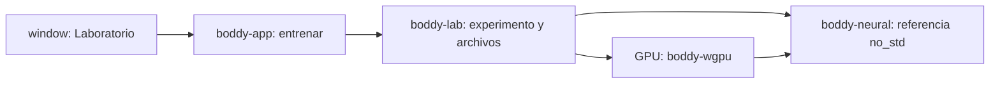

# Boddy Tiny 1.0: aprender a entrenar desde cero

Decisión del dueño: construir una arquitectura pequeña para aprender a entrenarla
en su RTX 3060 de 12 GB. Tiny es un modelo educativo de texto con pesos propios;
el chat y el investigador continúan usando Qwen. No hay extracción de documentos,
neuronas o datos originales de Qwen ni transferencia de sus pesos.

## Arquitectura y fronteras



MLP: contexto de ocho caracteres codificados one-hot, 32 unidades tanh, 96
salidas softmax. Son **27.776 parámetros**, 111.104 bytes de pesos f32.
Cada token equivale a un carácter: salto de línea o ASCII imprimible. No soporta
acentos, Unicode, instrucciones largas, atención ni herramientas. El núcleo
matemático usa no_std con alloc; requiere un asignador del consumidor.

Inicialización uniforme aleatoria de pesos, sesgos cero, semilla 1337. Pérdida de
entropía cruzada y SGD con tasa 0,2; lote 32, hasta 2.000 pasos. Forward, backprop
y actualización corren en shaders WGSL escritos en este repositorio. La muestra
de 256 caracteres se genera después con la referencia CPU, semilla 2026.

El corpus propio versionado `training/corpora/boddy-tiny-v1.txt` tiene 2.403 bytes
y frases educativas creadas para este experimento. No proviene de Qwen, del chat
del usuario ni de una descarga. Se reserva el último 20 % de líneas antes de
construir contextos. Se comparan los mismos 256 contextos distribuidos por cada
partición antes y después. Este corpus relacionado y diminuto no demuestra
generalización, capacidad para programar ni razonamiento.

## Usarlo

Abrir Boddy y seleccionar **Laboratorio**, elegir 300, 1.000 o 2.000 pasos y
pulsar **Entrenar en GPU** para crear un modelo. El menú de versiones permite
elegir un modelo guardado y **Continuar en GPU**; los pasos elegidos se añaden
a sus pesos. La versión nueva conserva al padre sin modificarlo y queda seleccionada
para la siguiente etapa. También funciona sin servidor Qwen:

```powershell
cargo build -p boddy-cli --offline
'{"steps":1000}' | .\target\debug\boddy-cli.exe entrenar
# Ventana sin iniciar Qwen:
powershell.exe -NoProfile -ExecutionPolicy Bypass -STA -File .\window\Boddy.ps1
```

El host guarda `data/lab/tiny-<id>/checkpoint.json`, `metrics.json` y `sample.txt`;
están ignorados por Git. El formato propio v3 usa JSON compacto para configuración,
tokenizer, semilla, estado de muestreo y referencia a los pesos. Los números se
guardan en `data/lab/blobs/<sha256>.f32le`: f32 little endian, 27.776 valores,
111.104 bytes. Versiones con pesos idénticos comparten ese archivo; se verifica
su tamaño, SHA256 y valores finitos antes de cargarlo. No se cuantiza ni redondea.
Se exige restauración bit a bit y la misma muestra tras leer del disco.
Los v2 antiguos conservan su estado completo y siguen cargando desde JSON.
Los v1 antiguos permiten continuar desde pesos, reiniciando el muestreador a 42;
se marca `weights_only_legacy` y se deja desconocido el total acumulado. No se
fabrica su historial. Reanudar exige mismo corpus y arquitectura compatibles.

En la prueba v3, el manifiesto JSON de un modelo de 600 pasos ocupó **576 bytes**,
los pesos **111.104 bytes** y métricas **2.830 bytes**. El checkpoint de la segunda
trayectoria 300 + 300 reutilizó los mismos pesos que 600 pasos seguidos: cero
bytes nuevos de pesos en esa escritura. Son tamaños de contenido, sin
asignación adicional del sistema de archivos. Evidencia:
`evals/tiny-storage-v3-rtx3060.json`. La ventana muestra estos tamaños.
La referencia v2 con exactamente los mismos bits de pesos ocupaba 576.096 bytes
de JSON; JSON v3 + binario suman 111.680 bytes (aproximadamente 80,6 % menos).
La comparación excluye métricas y muestra en ambos formatos.

Para copiar un modelo v3 hay que conservar su JSON y el blob referido, además de
las métricas si se quiere listar en la biblioteca. Los originales v1/v2 no se
borran ni convierten automáticamente. No hay limpieza automática de versiones.
Guardar versiones con pesos distintos sí consume espacio adicional.

En **Conversar**, el selector permite Qwen para chat o un Tiny guardado para
continuación experimental ASCII. Tiny usa solo los últimos ocho caracteres;
no recibe historial, mapa ni herramientas. Su generación usa CPU de referencia;
entrena por GPU. Cambiar modelo reinicia el historial y contadores; actualizar la
lista conserva el historial del modelo actual. Es selección entre los modelos
implementados, no importación de cualquier GGUF ni cambio de servidor remoto.

Comandos adicionales (JSON por entrada estándar):

```powershell
'{"action":"list"}' | .\target\debug\boddy-cli.exe modelo
# Sustituir tiny-<id> por un identificador real de la lista:
'{"steps":300,"parent_id":"tiny-<id>"}' | .\target\debug\boddy-cli.exe entrenar
'{"action":"generate","id":"tiny-<id>","prefix":"boddy ","max_tokens":64}' | .\target\debug\boddy-cli.exe modelo
```

Carga acotada: hasta 64 modelos entre 512 entradas, checkpoint máximo 2 MiB y
métricas 64 KiB. Se rechazan rutas externas/enlaces, versiones o formas
incompatibles y pesos no finitos. Los blobs Tiny deben medir exactamente 111.104
bytes. La lista informa inválidos y truncamiento.

El JSON describe el modelo; los pesos contienen los valores aprendidos. Reducir
el JSON no aumenta la capacidad ni elimina la memoria necesaria para la red.
Tiny ya es independiente de Qwen en entrenamiento y generación; Qwen sigue siendo
otra opción de chat. Autoaprendizaje general sin supervisión no está implementado:
este laboratorio aprende del corpus explícito y requiere evaluar los cambios.

La pantalla muestra pérdida de entrenamiento/validación, GPU real, tiempo,
tokens objetivo procesados, contexto por lote, pesos y buffers. Los 239.904 bytes
de buffers declarados excluyen compilador, driver, staging y otros procesos; no
son consumo total ni pico de VRAM. Tokens procesados incluyen repeticiones del
corpus y no significan datos nuevos. Las versiones se conservan para comparar;
una validación peor se muestra como tal, sin aprobar automáticamente el modelo.

Frases adicionales en `training/evals/tiny-language-v1.txt` quedan fuera de SGD.
Se informa pérdida y acierto del próximo carácter en 256 contextos fijos antes
y después. Son un control educativo, no una prueba ciega independiente ni una
medida de exactitud de respuestas. Usarlas repetidamente también orienta decisiones
del desarrollador; no deben confundirse con una evaluación final de capacidades.

## Comprobaciones y evolución

Antes de entrenar se compara pérdida y todos los gradientes GPU contra CPU,
además de una actualización SGD. Umbrales absolutos: pérdida 1e-4, gradientes y
actualización 5e-4. Las pruebas CPU incluyen diferencias finitas de gradientes,
descenso de pérdida y rechazo de tensores inválidos. El laboratorio comprueba
también límites del comando y alfabeto. La prueba nativa de ventana ejecuta
realmente el entrenamiento y comprueba el resultado sin alterar el chat.

Resultado observado desde la ventana en RTX 3060, 1.000 pasos: entrenamiento
4,5659 -> 1,8081; validación 4,5703 -> 2,1641. Error máximo absoluto de gradiente
7,45e-9. Registro versionado: `evals/tiny-v1-rtx3060.json`; contiene semilla,
hash del corpus y métricas de esa ejecución. El tiempo de una ejecución incluye
preparación y verificaciones; no es un benchmark estable de rendimiento.

Para crecer: primero corpus y evaluación independientes; luego soporte Unicode,
embeddings y contexto mayor, comparados con esta línea base. Un Transformer,
optimizadores como Adam, evaluación de código y autonomía operativa
son trabajo futuro. Añadir parámetros sin datos ni evaluación no garantiza mejoras.
La formación de un asistente general desde cero excede el alcance de este prototipo.

Prueba RTX 3060 de continuidad: 600 pasos seguidos frente a 300 + 300 reanudados
produjeron pesos iguales (error absoluto máximo observado 0), mismo muestreador
y SHA256 del padre intacto. En esa segunda etapa el control no entrenado mejoró
acierto de carácter 24,6 % -> 28,9 %. Evidencia en
`evals/tiny-continuation-v1-rtx3060.json`; reproducible con
`tools/Test-TinyContinuation.ps1`. No se garantiza igualdad entre drivers/hardware.

API contrastada con las fuentes oficiales de
[WGPU](https://docs.rs/wgpu/30.0.1/wgpu/) y
[libm](https://docs.rs/libm/latest/libm/). Las implementaciones y los pesos de este
experimento están en el proyecto; estas bibliotecas aportan cómputo y funciones
matemáticas, no conocimiento preentrenado.
